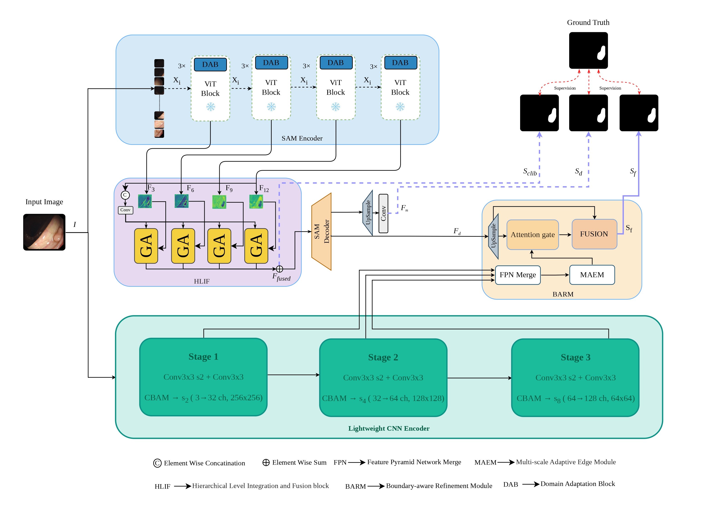

# BAHNet: Boundary-Aware Hybrid Network 🚀

Implementation of **BAHNet**, a hybrid model for polyp segmentation in colonoscopy images. It combines a SAM ViT-B image encoder with convolutional features designed to preserve spatial details and refine polyp boundaries.

## 🔗 Quick Links

- 🧩 [Model architecture](figures/model_architecture.jpg)
- 📄 [Training script](train.py)
- 🔍 [Evaluation script](evaluation.py)
- ⚖️ [License](LICENSE)

Datasets, SAM initialization weights, and trained BAHNet checkpoints are not distributed in this repository. Obtain the files separately and configure their paths as described below.

## 🧠 Project Structure

- `model/`: BAHNet, SAM-derived image encoder and mask decoder, transformer, and network blocks
- `dataset/`: dataset loader and local dataset files, if provided separately
- `utils/`: segmentation losses, PSL regularization, and average meter
- `py_sod_metrics/`: metric implementations used during evaluation
- `train.py`: training and checkpoint selection
- `evaluation.py`: prediction and metric evaluation
- `requirements.txt`: Python dependencies

The primary model is `BAHNet` in `model/bahnet.py`. Its main blocks include DAB with MSEB, HLIF, SPPE, and BARM with MAEM.

## 🧩 Model Architecture



## 🛠️ Environment Setup

Use Python 3.10–3.12. Create and activate a virtual environment:

```bash
python3 -m venv .venv
source .venv/bin/activate
python -m pip install --upgrade pip
```

Install the PyTorch build for your CPU or CUDA setup using the [official PyTorch installation guide](https://pytorch.org/get-started/locally/), then install the remaining project dependencies:

```bash
pip install -r requirements.txt
```

## 📚 Dataset Preparation

The dataset loader expects paired images and masks in `image/` and `mask/` directories. The training script reads `train/`; validation and evaluation read `test/`.

By default, the combined Kvasir and CVC-ClinicDB training images and masks are placed under `Kvasir/train/`. Keep the combined training data in this folder; the script does not load a separate ClinicDB training directory.

```text
dataset/
  SOD/
    Kvasir/
      train/
        image/
        mask/
      test/
        image/
        mask/
    CVC-ClinicDB/
      test/
        image/
        mask/
    CVC-ColonDB/
      test/
        image/
        mask/
    ETIS-Lari/
      test/
        image/
        mask/
```

Keep each image paired with its mask using matching filenames. Update the paths in the scripts if your dataset is stored elsewhere.

## 🏋️ Training

Download the SAM ViT-B checkpoint `sam_vit_b_01ec64.pth` and place it at the default path `pretrained/sam_vit_b_01ec64.pth`, or change `Args.encoder_ckpt` in `train.py`.

```bash
python train.py
```

Before training, review these settings in `train.py`:

- `Args.data_path`: the Kvasir folder containing the combined training data
- `Args.clinicdb_val_path`: the CVC-ClinicDB validation folder
- `Args.etis_val_path`: the ETIS-Lari validation folder
- `Args.encoder_ckpt`: SAM ViT-B initialization weights
- `Args.save_dir`: checkpoint and log output directory
- `Args.batch_size`, `Args.epochs`, `Args.img_size`: training configuration

Checkpoints and `training_log.csv` are saved under `output/` by default.

## 🔍 Evaluation / Inference

Set `Args.checkpoint` in `evaluation.py` to a trained BAHNet checkpoint, then run:

```bash
python evaluation.py
```

Review these settings in `evaluation.py` first:

- `Args.checkpoint`: trained model checkpoint
- `Args.data_path`: parent folder containing the dataset folders
- `Args.result_path`: location for predictions and the metrics CSV

Predicted masks are written to `results/<dataset>/` and metrics to `results/sod_metrics.csv` by default. Evaluation runs on Kvasir, CVC-ClinicDB, CVC-ColonDB, and ETIS-Lari.

## 📊 Reported Paper Results

| Dataset | mDice | mIoU | F-measure | S-measure | E-measure | MAE |
|---|---:|---:|---:|---:|---:|---:|
| CVC-ClinicDB | 0.953 | 0.907 | 0.962 | 0.959 | 0.989 | 0.006 |
| Kvasir-SEG | 0.942 | 0.895 | 0.963 | 0.938 | 0.981 | 0.014 |
| CVC-ColonDB | 0.821 | 0.742 | 0.869 | 0.882 | 0.919 | 0.021 |
| ETIS-LaribPolypDB | 0.804 | 0.731 | 0.858 | 0.889 | 0.934 | 0.012 |

These values are reported in the paper. Your results may differ with checkpoint, dataset preparation, and evaluation settings.

### Checkpoint-selection note

The current training script chooses checkpoints using the Kvasir, CVC-ClinicDB, and ETIS-Lari test splits. Therefore, scores on those splits are not independent held-out test estimates. CVC-ColonDB is evaluated after training but is not used for checkpoint selection.

## 📄 License

This project is licensed under Apache-2.0; see [LICENSE](LICENSE). SAM-derived components retain their upstream attribution in the source files.
